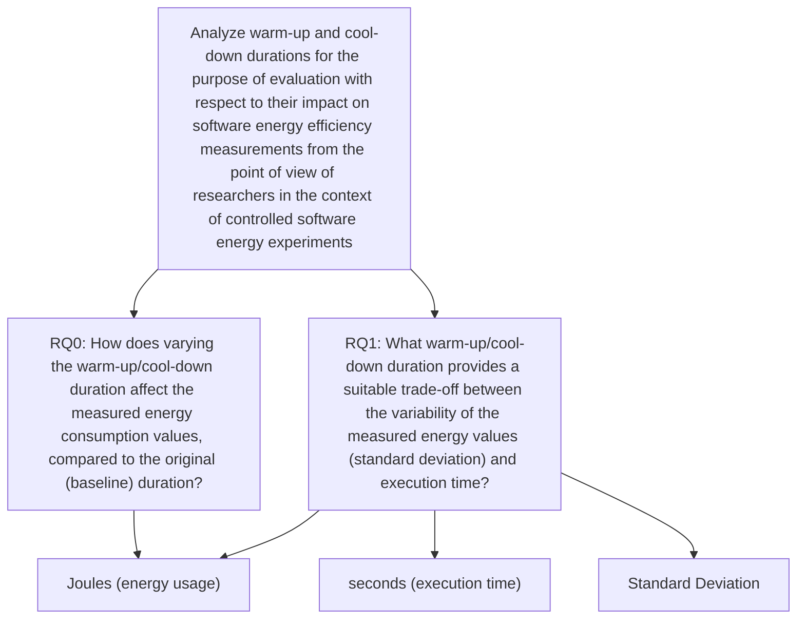

# Warm-up & Cool-down

**Ruxandra Nicu** (2800553) — VU Amsterdam — r.nicu@student.vu.nl
**Akram Sadoukri** (2804520) — VU Amsterdam — m.a.sadoukri@student.vu.nl
**Gijs Springintveld** (2809685) — VU Amsterdam — g.w.springintveld@student.vu.nl
**Timothy van Buuren** (2729382) — VU Amsterdam — t.b.van.buuren@student.vu.nl
**Alicja Sterańczak** (2808099) — VU Amsterdam — a.w.steranczak@student.vu.nl

---

## ABSTRACT

- **Context.** ✎ at the end
- **Goal.** ✎ at the end
- **Method.** ✎ at the end
- **Results.** ✎ at the end
- **Conclusions.** ✎ at the end

**ACM Reference Format:**
Ruxandra Nicu, Akram Sadoukri, Gijs Springintveld, Timothy van Buuren, and Alicja Sterańczak. 2020. Warm-up & Cool-down. In *Green Lab 2020/2021 - Vrije Universiteit Amsterdam, September–October, 2020, Amsterdam (The Netherlands)*. ACM, New York, NY, USA, 9 pages. https://doi.org/10.1145/nnnnnnn.nnnnnnn

---

## 1 INTRODUCTION

Driven by the rapid expansion of global computing infrastructure, software energy efficiency has transitioned from an internal performance optimization goal to a critical factor in mitigating the environmental impact of Information and Communications Technology (ICT). In 2020, the ICT sector used an estimated 4–6% of the global electricity production [1], with demand projected to rise sharply over the coming decade. Furthermore, Freitag et al. [2] found the ICT sector is responsible for as high as 2.1%–3.9% of the global greenhouse gas (GHG) emissions, noting an analyst consensus that ICT emissions will not reduce without major efforts involving broad political and industrial action. Without such action, the ICT sector's GHG emissions are projected to grow substantially: Andrae and Edler [3] predict a 1.7× to 2.8× increase by 2030 (reaching 1.50–4.78 GtCO2e¹), while Belkhir and Elmeligi [4] project a 2× to over 4× increase by 2040 (reaching 2.25–5.28 GtCO2e).

Empirical studies demonstrate that software-level decisions can have considerable effects on energy consumption: Pereira et al. [5] have shown, by implementing identical algorithms in different programming languages, that the choice of programming language alone can cause energy consumption to vary by more than an order of magnitude, while Shanbhag and Chimalakonda [6] have found that the choice of Python dataframe processing library can alter energy consumption by up to a factor of 200 for equivalent operations. This highlights that software-level decisions can considerably decrease energy expenditure, but leveraging this potential requires developers to actively understand and optimize their code for sustainability.

In practice, developers are increasingly aware of this: Pinto and Castor [7] reported that more than 70% of software developers surveyed are aware that energy consumption could be a potential issue in their applications. However, developers still struggle to translate their concerns into verifiable efficiency gains. The same study reveals a critical empirical deficit: among surveyed developers who attempted to resolve energy issues, nearly a third (31.81%) observed no noticeable improvement, and the vast majority relied merely on subjective perceptions (e.g., assessing whether the device's battery lasted longer) rather than quantitative data, with only a small minority using specialized tools. Furthermore, developers frequently resort to unverified documentation that lack empirical backing or trial-and-error.

Developer surveys reveal a fundamental gap: rigorously measuring software energy consumption is a technical challenge. Measuring software energy consumption is vulnerable to experimental noise [8]. Unlike traditional execution time experimentation, energy readings depend on physical phenomena such as CPU cold-start latency. Without a proper warm-up phase, the initial measurement runs capture cold caches, uninitialized memory pools and overhead from Just-In-Time (JIT) compilation, rather than the actual execution of the target program [9]. Conversely, starting measurement runs without cool-down interval allows residual heat from prior runs to accumulate. Warm-up and cool-down phases also aim to make sure that the hardware/OS conditions are the same across experimental runs (e.g., in terms of temperature, network card state, etc.).

To avoid such distortions, researchers use fixed-duration warm-up periods [11]. In practice, these intervals are configured using uncalibrated heuristics. For instance, recent empirical energy studies enforce multi-minute pauses—such as the 2-minute cool-down interval between runs adopted by Stoico et al. [12]—as a precautionary measure, yet without reporting empirical justification for the chosen duration. Automated benchmarking frameworks similarly embed fixed pause assignments by default (as illustrated in Figure 1). The lack of a golden standard creates a trade-off between measurement validity and experimental feasibility: padding each measurement run with long wait times could accumulate substantial linear overhead across repetitions, turning hours of execution into days. Conversely, aggressively truncating warm-up and cool-down intervals could risk drawing false conclusions from unrepresentative data.

```python
"""The time Experiment Runner will wait after a
run completes.
This can be essential to accommodate for cooldown
periods on some systems."""
time_between_runs_in_ms: int = 1000
```

*Figure 1: Configuration excerpt from Experiment Runner [10], specifying the default cool-down pause between runs.*

This research investigates the empirical impact of varying the durations of warm-up and cool-down on software energy benchmarking. Our findings aim to serve as a practical guide for researchers and developers in green software engineering. Specifically, this work provides evidence-based recommendations on selecting cost-effective warm-up and cool-down intervals that balance measurement fidelity (minimizing distortion in measured energy consumption relative to our 30-second thermal relaxation baseline) against total experimental execution time overhead. However it remains important to state that our results are not general but they are dependent on the controlled experiments that we chose to execute, on our environments.

¹ 1 GtCO2e = 10⁹ tonnes of carbon dioxide equivalent.

---

## 2 RELATED WORK

The non-determinism found in modern managed runtimes has long been recognized as a threat to the validity of performance measurements. Georges et al. [13] survey Java performance evaluation methodologies and show that many are not statistically rigorous, leading to misleading or incorrect conclusions in up to 16% of pairwise comparisons between alternatives such as garbage collectors. Their paper advocates computing confidence intervals across multiple VM invocations and, for steady-state performance, proposes an adaptive approach that determines the number of benchmark iterations needed once variability drops below a chosen threshold, rather than fixing this duration in advance. Their work is concerned exclusively with execution time, not energy consumption, and treats steady-state detection as an adaptive, per-benchmark process instead of an actual fixed warm-up or cool-down duration. Our study builds on their general insight that measurement variability must be understood to draw valid conclusions, but applies it to energy consumption and treats warm-up/cool-down duration itself as the independent variable, rather than detecting steady-state adaptively.

Prokopec et al. [11], in their evaluation of the Renaissance JVM benchmarking suite, take exactly this kind of fixed-duration approach, where each benchmark execution is done with a 5-minute warm-up period followed by 60 seconds of steady-state measurement, a duration the authors state was chosen so that major performance fluctuations from compilation occur before measurement, verified manually rather than adaptively. This is one concrete example of a fixed warm-up duration with no empirical justification, which is exactly what our study tests. Unlike our study, however, their work does not explicitly address cool-down and warm-up measurement at all.

Bechet et al. [14] apply similar concerns directly to energy measurement with EnergyTrackr, a tool that detects energy regressions across Java project commit histories. While the paper cites Cruz's guidelines [15] of resting the machine for roughly one minute between tests, their described implementation instead collects 5 warm-up samples to establish a baseline before checking subsequent samples for stability, and pauses execution based on CPU temperature rather than a fixed rest duration. This suggests that even when a guideline exists, it is not necessarily followed precisely in practice, leaving open the question of whether the specific duration chosen actually affects the resulting measurements.

Ardito et al. [16] propose a general methodological process for measuring the energy consumption of software applications. This is motivated by the observation that energy measurements are often obtained using ad hoc procedures, which can make comparison and replication difficult. Their process structures the experiment into the goal, measurement design, execution, and analysis phases and explicitly considers threats to validity, including the choice of device and context, measurement procedures, synchronization, sampling, and the number of repetitions. They also provided a case study that demonstrates how the process can be applied to obtain measurements that are documented and repeatable. The paper is closely related to our work because it treats the experimental procedure itself as an important factor in the validity and reproducibility of software-energy measurements. However, the authors do not experimentally investigate the effect of different warm-up or cool-down durations. Instead, their contribution is to provide a general framework for designing and documenting energy-consumption experiments. Our study narrows this methodological question by treating the warm-up/cool-down duration as the independent variable and empirically evaluating how changing it affects the measured energy consumption.

Mancebo et al. [17] similarly investigate how energy experiments with software should be designed and conducted to obtain reliable and consistent measurements. They propose a process covering the different stages of an energy-efficiency analysis, from defining the software and context under study to selecting measurement instruments, carrying out measurements, analyzing the collected data, and presenting the results. The process is based on the practices identified in previous research and is validated through two studies using different measurement approaches. Their work is relevant to our study because it emphasizes that methodological decisions made throughout an energy experiment can affect the reliability, consistency, replicability, and comparability of its results. In contrast to our work, however, Mancebo et al. [17] provide a general process rather than evaluating a particular experimental parameter. Although their study establishes a structured procedure for conducting software-energy measurements, our study focuses specifically on whether changing the duration of the warm-up and cool-down periods within such a procedure leads to differences in energy measurements and experimental conclusions.

In general, the five reviewed studies address different aspects of the reliability of software experiments and energy measurements. Georges et al. [13] show that variability in managed runtime performance can affect the validity of comparisons and argue for statistically rigorous repeated measurements and steady-state considerations. Prokopec et al. [11] provide an example of using a fixed warm-up period to reduce performance fluctuations before measurement, but do not investigate the choice of duration itself or energy consumption. Bechet et al. [14] show that EnergyTrackr uses a sample count for warm-up and replaces Cruz's [15] suggested one minute cool-down with a temperature-based condition instead, revealing that guidelines and practice can diverge. Ardito et al. [16] provide a structured methodology for designing repeatable software-energy measurements and identifying threats to validity, while Mancebo et al. [17] propose similarly a process intended to improve the reliability, consistency, and replicability of software-energy experiments.

Together, these studies establish that measurement variability, experimental procedure, and controlled execution conditions are relevant to the validity of software performance and energy experiments. However, reviewed studies generally treat warm-up or cool-down periods as part of a fixed experimental protocol, rather than systematically varying their duration and measuring the effect. This motivates our study, which uses the warm-up / cool-down duration as an experimental variable and investigates its effect on energy measurements and on the conclusions obtained from controlled software-energy experiments.

---

## 3 EXPERIMENT DEFINITION

### 3.1 GQM Method

We rely on the Goal-Question-Metric approach [18] to better structure our experiment by putting the most relevant details into the GQM diagram shown in Figure 2. It is made up of three main levels that help define the goal of the study, the research questions we aim to answer to reach the goal, and the metrics we need to measure to answer the questions.

At the highest level, the diagram presents our main objective, which is to examine how changes in the length of warm-up and cool-down periods influence the outcomes of controlled software energy experiments, as seen from the standpoint of researchers who plan and conduct these studies. The goal is to produce a guide of which cool-down/warm-up periods are the most efficient ones in terms of energy consumption and execution time. This is the output of our study, concerning the software developers community and fellow researchers.

The middle level contains our two research questions. RQ0 asks whether changing the warm-up/cool-down duration changes the measured energy consumption compared to a baseline run. On the other hand, RQ1 investigates the trade-off between measurement variability and total experiment time across the tested durations.

The bottom level contains the metrics used to answer the research questions. Energy consumption is measured in Joules and is used to answer RQ0. For RQ1, measurement variability is quantified using the standard deviation of the energy measurements across repeated runs, while total experiment time is measured in seconds. Together, these metrics allow us to evaluate how the tested warm-up/cool-down durations affect both measurement stability and experimental cost.

**Table 1: Goal Definition.**

| | |
|---|---|
| Analyze | warm-up and cool-down durations |
| for the purpose of | evaluation |
| with respect to | their impact on software energy efficiency measurements |
| from the point of view of | researchers |
| in the context of | controlled software energy experiments |

**Figure 2: GQM diagram.**



### 3.2 Research Questions

The main goal of this study is to determine whether and to what extent the duration of the warm-up and cool-down periods affects the outcome of controlled software experiments. To reach this goal, we formulate the following two research questions.

***RQ0: How does varying the warm-up/cool-down duration affect the measured energy consumption values, compared to the original (baseline) duration?*** Existing literature lacks a standard baseline duration [11], relying on arbitrarily chosen durations ranging from 0 to 120 seconds. To address this, we define a thermal relaxation baseline of 30 seconds for both cool-down and warm-up as our baseline standard.

This research question addresses the possibility that changing the warm-up/cool-down period, when executing a program, may result in different levels of energy consumption. RQ0 is quantified using total energy consumption, measured in Joules. RQ0 is therefore related to the first metric of the GQM diagram (Fig. 2).

***RQ1: What warm-up/cool-down duration provides a suitable trade-off between the variability of the measured energy values (standard deviation) and execution time?*** Shorter warm-up/cool-down durations reduce the total execution time of the experiment, but may increase the variability of the collected energy measurements. We quantify this variability as the standard deviation of the energy values collected across the runs for each tested duration. RQ1 therefore examines how measurement variability changes across the tested durations, and compares it against the corresponding execution time, in order to characterize the trade-off between measurement variability and total experiment time.

---

## 4 EXPERIMENT PLANNING

In this section we address the experimental variables, hypotheses and design, alongside the setup and tools used to measure the metrics.

### 4.1 Subjects Selection

At this stage of our experiment, which evaluates how warm-up and cool-down periods influence software energy measurements, we select a total of six benchmark subjects from two Python benchmark suites, namely Pyperformance [20] and the Computer Language Benchmarks Game [19].

Different software workloads do not interact the same with hardware sub-systems. Application types such as memory-bound, compute-bound or garbage collection-bound have different thermal sensitivity and therefore, we select benchmarks from three operational categories to act as both treatment subjects and experimental controls.

The **High Compute** category indicates maximum thermal sensitivity and includes two main benchmarks from our chosen benchmark suite (Table 2): N-Body and Spectral Norm. They represent pure CPU-bound mathematical computations with continuous vector and floating-point operations. The workloads these benchmarks have rapidly exceed CPU core thermal capacity, and thus it makes them ideal for detecting thermal throttling, execution time changes, and energy measurement drift under insufficient cool-down periods.

The second category, **Moderate Thermal Sensitivity**, includes benchmarks from the Scimark suite within Pyperformance [20]. We choose LU, SOR, and Sparse Matrix Multiplication. These workloads combine intensive floating-point arithmetic with continuous L1, L2, L3 cache system memory access. This way, we can observe whether memory bus delays interact with thermal clock degradation.

The third category, **Neutral Thermal Sensitivity**, targets memory-bound and garbage collection control workloads, and includes the Binary Trees benchmark extracted from the Computer Language Benchmarks Game [19]. It repeatedly allocates, traverses and deallocates dynamic binary tree nodes to memory. As execution time is mostly constrained by heap allocation latency, pointer chasing and Python's garbage collection rather than continuous floating-point calculations, it generates minimal core heat. It is a negative control to verify that variations in warm-up and cool-down periods do not distort non-compute-heavy operations.

We choose to work with these three categories to capture a broader spectrum of thermal generation in modern processor architectures, following methodological principles established by Georges et al. [21] for multi-workload benchmark evaluations. CPU core operations, memory bus access and RAM allocation affect temperature differently. Continuous arithmetic logic unit execution generates peak thermal energy, while memory access creates lower dynamic power draw, as analyzed by Skadron et al. [22]. Finally, idle heap management generates minimal heat, supported by the findings of Xian et al. [23]. Classifying the chosen benchmarks across these three separate categories allows us isolate whether thermal changes are a universal issue across all software executions or an isolated experience confined to compute-heavy workloads.

We explicitly exclude the remaining two benchmarks within the Scimark suite: Fast Fourier Transform and Monte Carlo, as the first one relies on bit-reversal and complex array re-indexing that closely represents the memory access patterns of Sparse Matrix Multiplication. Similarly, Monte Carlo includes lightweight random number generation loops whose continuous CPU demand is already covered by N-Body and Spectral Norm. Including these two benchmarks would be redundant workload profiles while increasing overall experimental execution time without providing additional analytical value.

Consequently, restricting our subject pool to these six workloads yields a non-redundant, balanced experimental matrix across all treatment combinations.

**Table 2: Selected Benchmark Subjects, Target Workload Characteristics, and Thermal State Expectations**

| Benchmark | Source | Workload Category | Primary Target/Hardware Focus | Expected Thermal Behavior |
|---|---|---|---|---|
| N-Body | Benchmarks Game [19] | floating-point math | CPU cores, vector math | high variance; severe thermal throttling risk |
| Spectral Norm | Benchmarks Game [19] | compute-intensive | CPU core throughput, math loops | high variance; rapid CPU temperature rise |
| LU (Scimark) | PyPerformance [20] | linear algebra | CPU ALU, L1/L2/L3 cache bandwidth | moderate-high variance; memory/compute bound |
| SOR (Scimark) | PyPerformance [20] | stencil computation | CPU cache locality, memory bus | moderate variance; sustained dynamic power |
| Sparse-MatMult (Scimark) | PyPerformance [20] | matrix operations | memory bandwidth, indirect addressing | moderate variance; memory latency sensitive |
| Binary Trees | Benchmarks Game [19] | GC & memory system | RAM, heap allocation, GC overhead | low/zero variance; CPU thermal neutral baseline |

### 4.2 Experimental Variables

In this experiment, we evaluate the impact that different warm-up and cool-down periods have on the selected benchmarks discussed in the previous sub-section. We choose these periods in the following order: 5 seconds, 30 seconds, 60 seconds, 120 seconds and 210 seconds. This decision is further justified in the next sub-sections. In order to properly conduct this experiment and correctly answer the research questions, this study defines a set of dependent, independent and controlled variables.

Factors are defined as independent variables, manipulated throughout the experimental process, with the scope of observing their effect on measurement reliability and execution time. The primary factor in this study is the warm-up and cool-down duration, as stated above, comprising five treatment levels: 5s, 30s, which is the defined thermal relaxation baseline standard, 120s and 210s. This factor is of interval type, as the durations are a continuous, ordered scale with equal intervals measured in seconds, allowing quantitive comparisons accross durations. The second independent variable is the benchmark subject, which consists of six different workloads categorized into three thermal sensitivity classes: High-Compute, Moderate Thermal Sensitivity and Neutral Thermal Sensitivity (Table 2). The benchmark subject is a nominal factor, as it includes distinct named categories with no inherent mathematical order.

Controlled variables are also independent variables, however, they are constant throughout the entirety of the experiment to prevent confounding physical or software-level influences. In this case, the controlled variables are the underlying physical hardware infrastructure, operating system settings, network state and environmental conditions.

We define the experimental objects receiving the treatments to be the six selected benchmark subjects extracted from the Computer Language Benchmarks Game [19] and Pyperformance [20]. Their workloads represent different computational profiles: pure CPU-bound floating-point arithmetic (N-Body, Spectral Norm), memory-bound cache and dynamic power access (LU, SOR, Sparse-MatMult), and garbage collection/heap management control workloads (Binary Trees). In total, crossing 5 duration levels with 6 benchmarks subjects yields 30 unique treatment combinations. Executing 25 balanced and fully randomized repetitions per combination results in 750 individual benchmark runs.

The dependent variables are the outcomes we observe and analyze from the manipulation of independent variables. They are the energy consumption measured in Joules, the measurement variability and the execution time measured in seconds. The first mentioned dependent variable is the total energy drawn by the CPU during benchmark execution and measured via EnergiBridge. RQ0 directly addresses this variable and it is of ratio type, because Joules possess a continuous numerical scale with a true absolute zero point, which indicates that no energy was consumed at all during an execution.

The following variable, measurement variability is quantified as the standard deviation of energy consumption readings accross repetitions for each of the duration-benchmark pair. RQ1 addresses this variable, which is also of type ratio. Finally, the execution time variable is measured in seconds and it is the total duration of a program execution and idle pause intervals recorded in seconds. It is used in combination with variability to answer RQ1, in regards with trade-offs, this variable is also of ratio type, as it allows direct relative comparison.

### 4.3 Experimental Hypotheses

Let $Y_{ijk}$ denote the energy consumption (in Joules) of repetition $k$ of benchmark $j$ under duration level $i$, with $i = 1, \dots, 5$ (duration levels: 5s, 30s, 60s, 120s, 210s), $j = 1, \dots, 6$ (benchmark subjects, Table 2), and $k = 1, \dots, 25$. We define $\tau_i$ as the effect of duration level $i$, $\beta_j$ as the effect of benchmark $j$, and $(\tau\beta)_{ij}$ as the interaction effect between duration and benchmark, consistent with the two-factor factorial design described in Section 4.4.

**RQ0 (Energy Consumption).** RQ0 asks whether varying warm-up/cool-down duration changes measured energy consumption relative to the 30s baseline. As the design crosses duration with benchmark subject, we formulate three pairs of hypotheses, corresponding to the main effect of duration, the main effect of benchmark, and their interaction.

$$H_{0,A}: \tau_d = \tau_{30}\ \forall d \in \{5, 60, 120, 210\}$$
$$H_{1,A}: \exists d \in \{5, 60, 120, 210\} \mid \tau_d \neq \tau_{30}$$

$$H_{0,B}: \beta_1 = \beta_2 = \dots = \beta_6 = 0$$
$$H_{1,B}: \exists j \mid \beta_j \neq 0$$

$$H_{0,AB}: (\tau\beta)_{ij} = 0\ \forall i, j$$
$$H_{1,AB}: \exists (i, j) \mid (\tau\beta)_{ij} \neq 0$$

$H_{0,A}$ states that warm-up/cool-down duration has no effect on energy consumption compared to the 30s baseline; rejecting it answers RQ0 directly. $H_{0,B}$ states that benchmark identity has no effect on (baseline-relative) energy consumption, included for model completeness rather than as a primary question. $H_{0,AB}$ states that the effect of duration is consistent across all benchmarks; rejecting it indicates that thermal sensitivity to short durations is specific to certain workloads rather than a universal issue.

**RQ1 (Variability–Time Trade-Off).** RQ1 asks which duration offers a suitable trade-off between measurement variability and execution time. For RQ1, variability is measured as the absolute deviation from the median, $A_{ijk} = |Y_{ijk} - M_{ij}|$, where $M_{ij}$ is the median of the 25 repetitions of benchmark $j$ at duration $i$ (the standard deviation is reported descriptively). Let $\tau'_i$, $\beta'_j$ and $(\tau\beta)'_{ij}$ be the duration, benchmark and interaction effects on $A_{ijk}$. Since idle times grows as $2d_i$, a duration is suitable for benchmark $j$ if it is the shortest one whose deviations are not significantly larger than those at 210s (BH-adjusted one-sided comparisons) and whose mean deviation is at most 10% above that at 210s. The recommended duration overall is the longest of these per-benchmark durations.

$$H'_{0,A}: \tau'_1 = \dots = \tau'_5 = 0$$
$$H'_{1,A}: \exists i \mid \tau'_i \neq 0$$

$$H'_{0,B}: \beta'_1 = \dots = \beta'_6 = 0$$
$$H'_{1,B}: \exists j \mid \beta'_j \neq 0$$

$$H'_{0,AB}: (\tau\beta)'_{ij} = 0\ \forall i, j$$
$$H'_{1,AB}: \exists (i, j) \mid (\tau\beta)'_{ij} \neq 0$$

Rejecting $H'_{0,A}$ indicates that measurement variability ($A_{ijk}$) differs across duration levels. Post-hoc testing will then determine if shorter durations specifically produce less reliable energy readings, which is evaluated against our decision criterion to characterize the optimal trade-off. As with RQ0, the interaction hypothesis $H'_{0,AB}$ tests whether this variability-duration relation generalizes across benchmarks or is workload-specific.

### 4.4 Experiment Design

This experiment follows a two-factor factorial design with randomization and balancing. The main factor is warm-up/cool-down duration (5 levels), chosen to directly answer RQ0 and RQ1. The co-factor is benchmark subject (6 levels, Table 2), included not as a nuisance variable to control for, but because we want to test its interactions with duration, i.e. whether thermal sensitivity to short warm-up/cool-down periods is consistent across workload types or confined to specific thermal categories. All combinations of duration × benchmark are fully crossed (full factorial design), with the execution order being randomized across all runs and an equal number of repetitions (balancing) assigned to every combination.

We test five duration levels: 5s (near-zero value, RQ0's point of comparison against any warm-up at all), 30s (our defined baseline per RQ0), 60s (matches Cruz's guideline [15]), 120s, and 210s (upper-range point).

Execution order is fully randomized across all (duration × benchmark × repetition) runs, drawn as a single pool rather than executed in sequential blocks per duration level or per benchmark. This, together with the cool-down after each run, reduces the risk that ambient temperature drift, time-of-day effects, or thermal buildup in the machine correlate systematically with any one treatment. We run 25 repetitions per combination, within the recommended 20–30 range, chosen as a midpoint that keeps total experiment time comfortably inside the target window (below) while still permitting adjustment in either direction if pilot timing differs from our estimation.

Idle time per full pass across all five levels, per benchmark, per repetition: 2 × (5 + 30 + 60 + 120 + 210) = 2 × 425 = 850 s. Across six benchmarks × 25 repetitions: 850 × 6 × 25 = 127,500 s = 35.4 hours of idle time. Adding the estimated benchmark execution times (5–60 s per run depending on workload, across 5 × 6 × 25 = 750 runs): 750 × 5 s ≈ 1 hour to 750 × 60 s ≈ 12.5 hours. The total estimated experiment duration is therefore ~36–48 hours, within the 20–50 hour target and well under the 72-hour ceiling.

If pilot runs push the estimate toward the ceiling, we trim in this order. (1) Reduce repetitions to 20, which is still within the recommended range. (2) Drop the 210s level, and (3) as a last resort reduce from six benchmarks to four, dropping one per thermal category rather than an entire category, to preserve the three-way thermal sensitivity comparison from Section 4.1.

### 4.5 Data Analysis

The experiment produces 750 energy observations (five warm-up/cool-down durations, six benchmark subjects, 25 repetitions per combination), which are analyzed for RQ0. The standard deviation used in RQ1 yields only 30 values, so the variance hypotheses are tested on the 750 absolute deviations from the combination medians instead. For every trial, the total energy consumption of the benchmark execution is measured in Joules and the total experiment time, including warm-up, benchmark execution, and cool-down, is recorded in seconds. The analysis consists of data preparation, data exploration, normality checking, hypothesis testing, and effect size estimation. A significance level of $\alpha = 0.05$ is used throughout the analysis.

**Data Preparation.** Since the selected benchmarks represent different workloads and may differ substantially in their absolute energy consumption, raw energy measurements are not directly compared across benchmarks. To support comparisons across benchmarks, we additionally calculate the relative change in energy consumption with respect to the median energy consumption of the 30-second baseline for the corresponding benchmark. Failed, incomplete, or otherwise invalid runs are re-executed when possible. Otherwise the run is excluded from the analysis, and the number of excluded runs is reported. Potential outliers are inspected using box plots but are retained unless there is evidence that they result from a measurement error.

**Data Exploration.** For each duration–benchmark combination, descriptive statistics are calculated over the 25 repetitions, including the mean, median, standard deviation, minimum, and maximum energy consumption. Box plots and density plots are used to visualize the distribution of energy measurements across the five durations separately for each benchmark. For RQ1, the standard deviation of the energy measurements is additionally plotted across the tested durations to visualize changes in measurement variability.

**Normality Checking.** Before selecting the statistical tests, the distributions of the energy measurements are inspected using Q–Q plots and the Shapiro–Wilk test with a significance level of $\alpha = 0.05$. For the factorial model, the normality of the residuals is also examined using Q–Q plots, while homogeneity of variance across treatment groups is assessed using Levene's test.

If the assumptions required for parametric analysis are not satisfied, an appropriate transformation, such as a logarithmic or square-root transformation, is applied and the assumptions are checked again. The same transformation is applied consistently to all observations of the dependent variable. If the assumptions remain violated, a non-parametric alternative is used. Descriptive statistics and plots are reported using the original, non-transformed measurements.

**Hypothesis Testing.** For RQ0, if the assumptions of parametric analysis are satisfied, a two-way factorial ANOVA is applied to energy consumption with warm-up/cool-down duration and benchmark subject as factors, including their interaction. If the assumptions remain violated after transformation, an Aligned Rank Transform (ART) factorial analysis is used instead. If a significant duration effect or interaction is found, each alternative duration (5, 60, 120, and 210 seconds) is compared with the 30-second baseline within each benchmark using an independent-samples $t$-test for parametric data or the Mann–Whitney U test otherwise. The resulting $p$-values are adjusted using the Benjamini–Hochberg procedure.

For RQ1, measurement variability is represented by the standard deviation of the 25 energy measurements in each duration–benchmark combination. Differences in variability are analysed using the absolute deviations of the measurements from the median of their corresponding combination. These deviations are analysed using the same factorial ANOVA or ART procedure as for RQ0, with duration, benchmark, and their interaction as factors. Measurement variability is then considered together with total experiment time by plotting standard deviation against experiment time for each duration and benchmark.

**Effect Size.** For statistically significant post-hoc comparisons, Cohen's $d$ is reported for parametric comparisons and Cliff's delta for non-parametric comparisons. Relative changes in energy consumption with respect to the 30-second baseline are additionally reported to show the practical magnitude of the observed differences.

---

## 5 EXPERIMENT EXECUTION

### 5.1 Hardware and Software Setup

All 25 tests are executed on a single dedicated machine, so the hardware is identical across treatments. Table 3 summarizes the setup. These settings implement the controlled variables defined in Section 4.2: the machine is connected to main power, Wi-Fi, Bluetooth, and Ethernet are disabled, and all non-essential applications and background services are closed.

**Table 3: Experimental setup.**

| | |
|---|---|
| Machine | Raspberry Pi 3 Model B+ |
| CPU | Cortex-A53 (ARMv8, 64-bit) |
| SoC | Broadcom BCM2837B0, quad-core |
| RAM | 1 GB LPDDR2 SDRAM |
| OS / kernel | Raspberry Pi OS |
| Python | Python 3.14.8 |
| Energy tool | EnergiBridge |
| Orchestrator | Experiment Runner |

### 5.2 Tools

To ensure reproducibility, automated execution, and accurate telemetry, two primary tools are used in our experimental pipeline.

**Experiment Runner.** We use Experiment Runner [10], an open-source framework designed for the automated orchestration of measurement-based experiments on software systems. Experiment Runner executes the measurement matrix defined in our run table by systematically managing experimental factors, treatment variations, and repetitions. Crucially, it handles the complete pseudo-randomization of test order across treatments, manages automated warm-up and cool-down idling periods between consecutive runs, logs aggregated run metadata, and provides persistency and restart mechanisms in the event of run crashes.

**EnergiBridge.** To monitor power draw and duration, EnergiBridge [24] is installed directly on the target machine. EnergiBridge is invoked by Experiment Runner as a wrapper around each benchmark run to track energy consumption (in Joules) and execution time (recorded in milliseconds and subsequently converted to seconds for analysis). By reading low-level hardware performance and energy counters with minimal runtime overhead, EnergiBridge provides reliable, non-intrusive consumption measurements for each individual execution.

**Benchmark Suite and Runtime Scripts.** The target workloads are implemented as standalone Python executables managed under Python 3.14.8. Shell and Python helper scripts interfaced through Experiment Runner's configuration hooks handle machine state validation, pre-run resource cleanup, and structured output formatting into unified CSV results.

### 5.3 Execution Protocol

Each test is driven by the Experiment Runner hooks and follows the same sequence:

1. **Warm-up:** the machine idles for $d \in \{5, 30, 60, 120, 210\}$ seconds, as assigned in the run table.
2. **Measurement:** EnergiBridge starts and executes the assigned benchmark once, recording the energy (J) and execution time (s) of the run.
3. **Cool-down:** the machine idles for the same duration $d$.
4. **Logging:** energy, benchmark time, total experiment time (warm-up + run + cool-down), benchmark, duration level, repetition number, and timestamp are appended to the results table.

Because the order is fully randomized over the entire pool, consecutive tests generally differ in benchmark and duration level, so no treatment systematically inherits the thermal state of another. The total experiment time is the execution time used to answer RQ1.

Before the experiment, we conduct a pilot of 3 tests to check that the pipeline works from end to end and to refine the time estimate from Section 4.4. The machine is rebooted and left idle for 5 minutes before the first test. If a test fails (e.g., a crash or missing EnergiBridge output), it is logged and re-executed when possible. Otherwise, it is excluded from the analysis. The number of excluded runs is reported in Section 6. The full pass of the experiment is expected to take roughly 36–48 hours.

---

## 6 RESULTS

*Provide:*
- *descriptive statistics*
- *hypothesis testing*

*Provide suitable plots and tables to illustrate your results.*

**Figure 3: Energy consumption per run (J) for each warm-up/cool-down duration, one panel per benchmark (log scale). Boxes show the quartiles and the median, whiskers extend to 1.5×IQR, and dots are individual runs (n = 25 per box). The 30 s baseline is orange.**

*(Figure not included: six box-plot panels — N-Body, Spectral Norm, LU (Scimark), SOR (Scimark), Sparse-MatMult (Scimark), Binary Trees — with x-axis "Warm-up/cool-down duration (s)" at 5, 30, 60, 120, 210 and y-axis "Energy consumption (J)". Insert the image file here, e.g. ``.)*

### 6.1 Descriptive Statistics

**Data overview.** All 750 runs (5 durations × 6 benchmarks × 25 repetitions) were completed, and no run was excluded. Two runs (LU at 120 s and SOR at 5 s) did not finish in the main pass and were executed again afterwards, so they are not part of the randomized order.

**Energy.** Figure 3 shows the energy per run for every benchmark and duration. The distributions overlap strongly in all benchmarks, and the median does not change consistently with the duration. For example, the median energy of N-Body is 5.2 J at 30 s, 1.9 J at 60 s, and 4.7 J at 210 s. The 60 s level has the lowest median in four of the six benchmarks, but in LU and SOR it lies above the 30 s baseline by 15% and 19%. The spread is large relative to the median, especially for the short benchmarks (N-Body, Spectral Norm, Binary Trees), which consume only about 1–4 J per run. Runs with unusually high energy occur at every duration. The box plots therefore do not show a clear effect of the duration.

**Time.** The total time per run is determined mostly by the design (about twice the duration plus the benchmark runtime). Its median increases from 11–33 s at a duration of 5 s to 421–443 s at 210 s. The runtime of the benchmark itself does not depend on the duration: the medians of the five durations differ by at most about 1% in every benchmark, so differences in energy are not caused by a change in execution speed.

**Table 4: Median energy per run in J (standard deviation in parentheses) and median total time per run in s, for every benchmark and warm-up/cool-down duration (n = 25 per cell).**

| Benchmark | Energy 5 s | Energy 30 s | Energy 60 s | Energy 120 s | Energy 210 s | Time 5 s | Time 30 s | Time 60 s | Time 120 s | Time 210 s |
|---|---|---|---|---|---|---|---|---|---|---|
| N-Body | 3.6 (3.8) | 5.2 (5.5) | 1.9 (3.8) | 4.0 (7.3) | 4.7 (6.9) | 12.4 | 62.4 | 122.3 | 242.4 | 422.4 |
| Spectral Norm | 1.4 (1.7) | 1.2 (3.1) | 0.6 (1.3) | 1.4 (2.5) | 1.2 (1.5) | 11.1 | 61.1 | 121.1 | 241.1 | 421.1 |
| LU | 208.3 (82.5) | 163.0 (89.2) | 187.4 (65.6) | 181.5 (54.2) | 196.9 (78.4) | 32.5 | 82.5 | 142.5 | 262.6 | 442.5 |
| SOR | 139.1 (68.5) | 135.3 (37.8) | 160.7 (88.5) | 121.7 (41.2) | 123.2 (48.9) | 29.3 | 79.3 | 139.4 | 259.4 | 439.4 |
| Sparse-MatMult | 15.1 (6.5) | 13.1 (9.4) | 11.2 (8.3) | 13.3 (9.5) | 12.7 (10.8) | 13.6 | 63.6 | 123.6 | 243.6 | 423.6 |
| Binary Trees | 0.9 (1.2) | 0.9 (1.6) | 0.3 (0.9) | 0.5 (0.6) | 0.8 (2.1) | 10.9 | 60.9 | 120.9 | 240.9 | 420.9 |

### 6.2 Assumption Checks

*Page limit: Open - go deep as you wish*

---

## 7 DISCUSSION

*Report implications and interpretations of your results (possibly grouped by research question).*

*Page limit: 1*

---

## 8 THREATS TO VALIDITY

*Report about each type of threat to the validity of the experiment, according to the classification discussed in class.*

### 8.1 Internal Validity

### 8.2 External Validity

### 8.3 Construct Validity

### 8.4 Conclusion Validity

*Page limit: 1*

---

## 9 CONCLUSIONS

*One brief paragraph for summarizing the main findings of the report.*

*One brief paragraph about the possible extensions of the performed experiment (imagine that other 3 teams will be assigned to the extension of your experiment).*

---

## TIME LOG

The time log for this project can be found here - Time log.

## AI USE DECLARATION

Generative AI tools were used to help with proofreading, grammar correction, generating a python file to plot the figures using our benchmark results and overall improving the clarity of the text. Examples of such tools include Grammarly and Claude.

---

## REFERENCES

1. A. Ross and L. Christie, "Energy consumption of ICT," The Parliamentary Office of Science and Technology, Westminster, London, Tech. Rep. 677, 2022, accessed: 2023-11-21. [Online]. Available: https://post.parliament.uk/research-briefings/post-pn-0677/
2. C. Freitag, M. Berners-Lee, K. Widdicks, B. Knowles, G. S. Blair, and A. Friday, "The real climate and transformative impact of ict: A critique of estimates, trends, and regulations," *Patterns*, vol. 2, no. 9, p. 100340, 2021. [Online]. Available: https://www.sciencedirect.com/science/article/pii/S2666389921001884
3. A. S. G. Andrae and T. Edler, "On global electricity usage of communication technology: Trends to 2030," *Challenges*, vol. 6, no. 1, pp. 117–157, 2015. [Online]. Available: https://www.mdpi.com/2078-1547/6/1/117
4. L. Belkhir and A. Elmeligi, "Assessing ict global emissions footprint: Trends to 2040 recommendations," *Journal of Cleaner Production*, vol. 177, pp. 448–463, 2018. [Online]. Available: https://www.sciencedirect.com/science/article/pii/S095965261733233X
5. R. Pereira, M. Couto, F. Ribeiro, R. Rua, J. Cunha, J. P. Fernandes, and J. Saraiva, "Energy efficiency across programming languages: how do energy, time, and memory relate?" in *Proceedings of the 10th ACM SIGPLAN International Conference on Software Language Engineering*, ser. SLE 2017. New York, NY, USA: Association for Computing Machinery, 2017, p. 256–267. [Online]. Available: https://doi.org/10.1145/3136014.3136031
6. S. Shanbhag and S. Chimalakonda, "On the Energy Consumption of Different Dataframe Processing Libraries – An Exploratory Study," *arXiv (Cornell University)*, 9 2022. [Online]. Available: http://arxiv.org/abs/2209.05258
7. G. Pinto and F. Castor, "Energy efficiency: a new concern for application software developers," *Commun. ACM*, vol. 60, no. 12, p. 68–75, Nov. 2017. [Online]. Available: https://doi.org/10.1145/3154384
8. T. Mytkowicz, A. Diwan, M. Hauswirth, and P. F. Sweeney, "Producing wrong data without doing anything obviously wrong!" *SIGPLAN Not.*, vol. 44, no. 3, p. 265–276, Mar. 2009. [Online]. Available: https://doi.org/10.1145/1508284.1508275
9. A. Georges, D. Buytaert, and L. Eeckhout, "Statistically rigorous java performance evaluation," *SIGPLAN Not.*, vol. 42, no. 10, p. 57–76, Oct. 2007. [Online]. Available: https://doi.org/10.1145/1297105.1297033
10. M. Karsten, A. Dragomir, R. Apsan, V. Stoico, and I. Malavolta, "Experiment Runner: a Tool for the Automatic Orchestration of Experiments Targeting Software Systems," *Science of Computer Programming*, vol. 1, p. 103415, 2025. [Online]. Available: https://www.sciencedirect.com/science/article/pii/S0167642325001546
11. A. Prokopec, A. Rosà, D. Leopoldseder, G. Duboscq, P. Tma, M. Studener, L. Bulej, Y. Zheng, A. Villazón, D. Simon et al., "On evaluating the renaissance benchmarking suite: Variety, performance, and complexity," *arXiv preprint arXiv:1903.10267*, 2019. [Online]. Available: https://doi.org/10.48550/arXiv.1903.10267
12. V. Stoico, A. C. Dragomir, and P. Lago, "An empirical study on the performance and energy usage of compiled python code," in *Proceedings of the 29th International Conference on Evaluation and Assessment in Software Engineering*, ser. EASE '25. New York, NY, USA: Association for Computing Machinery, 2025, p. 46–56. [Online]. Available: https://doi.org/10.1145/3756681.3756972
13. A. Georges, D. Buytaert, and L. Eeckhout, "Statistically rigorous java performance evaluation," *ACM SIGPLAN Notices*, vol. 42, no. 10, pp. 57–76, 2007. [Online]. Available: https://doi.org/10.1145/1297027.1297033
14. F. Bechet, J. Maquoi, L. Cruz, B. Vanderose, and X. Devroey, "Systematic detection of energy regression and corresponding code patterns in java projects," *arXiv preprint arXiv:2604.19373*, 2026. [Online]. Available: https://doi.org/10.48550/arXiv.2604.19373
15. L. Cruz, "Green software engineering done right: a scientific guide to set up energy efficiency experiments," Oct. 2021. [Online]. Available: https://luiscruz.github.io/2021/10/10/scientific-guide.html
16. L. Ardito, R. Coppola, M. Morisio, and M. Torchiano, "Methodological guidelines for measuring energy consumption of software applications," *Scientific Programming*, vol. 2019, no. 1, p. 5284645, 2019. [Online]. Available: https://doi.org/10.1155/2019/5284645
17. J. Mancebo, F. García, and C. Calero, "A process for analysing the energy efficiency of software," *Information and Software Technology*, vol. 134, p. 106560, 2021. [Online]. Available: https://www.sciencedirect.com/science/article/pii/S0950584921000446
18. R. van Solingen, V. R. Basili, G. Caldiera, and H. D. Rombach, "Goal question metric (gqm) approach," in *Encyclopedia of Software Engineering*, J. J. Marciniak, Ed. John Wiley & Sons, Inc., 2002. [Online]. Available: https://onlinelibrary.wiley.com/doi/abs/10.1002/0471028959.sof142
19. I. Gouy, "The Computer Language Benchmarks Game," https://benchmarksgameteam.pages.debian.net/benchmarksgame/index.html, 2026, accessed: 06-04-2026.
20. Python Software Foundation, "pyperformance: The Python benchmark suite," https://github.com/python/pyperformance, 2026, accessed: 06-05-2026.
21. A. Georges, D. Buytaert, and L. Eeckhout, "Java performance evaluation revisited," in *Proceedings of the 22nd Annual ACM SIGPLAN Conference on Object-Oriented Programming, Systems, Languages, and Applications (OOPSLA)*, 2007, pp. 149–164. [Online]. Available: https://doi.org/10.1145/1297027.1297033
22. K. Skadron, M. R. Stan, W. Huang, S. Velusamy, K. Sankaranarayanan, and D. Tarjan, "Temperature-aware microarchitecture," in *Proceedings of the 30th Annual International Symposium on Computer Architecture (ISCA)*, 2003, pp. 2–13. [Online]. Available: https://doi.org/10.1145/859618.859620
23. F. Xian, W. Srisa-an, and H. Jiang, "Controlling energy consumption of garbage collection in embedded java systems," in *Proceedings of the 6th International Symposium on Memory Management (ISMM)*, 2007, pp. 155–166. [Online]. Available: https://doi.org/10.1145/1296907.1296927
24. J. Sallou, L. Cruz, and T. Durieux, "Energibridge: Empowering software sustainability through cross-platform energy measurement," 2023. [Online]. Available: https://arxiv.org/abs/2312.13897